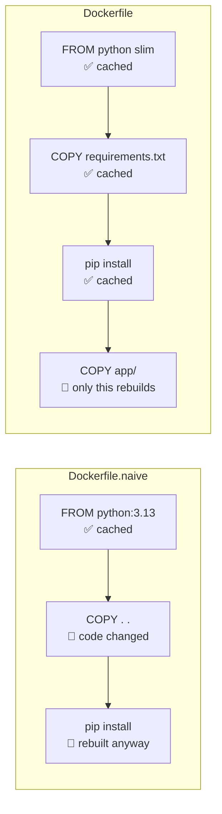

# secure-python-docker

Most Dockerfiles I get asked to look at have the same three problems. They run as root. They ship an entire operating system the app never touches. And they reinstall every dependency whenever someone fixes a typo, so a one-line change means waiting for pip all over again.

This repo is how I build Python images instead. The app is a tiny FastAPI service on purpose. The interesting part is the [`Dockerfile`](Dockerfile). Every line in it is there for a reason, and this README explains those reasons, including when *not* to do some of these things.

There's also a [`Dockerfile.naive`](Dockerfile.naive) that does everything the "normal" way, so you can compare the two yourself.

## The numbers

Both Dockerfiles built back to back on a fresh GitHub Actions runner by the [benchmark workflow](.github/workflows/benchmark.yml). Nothing here is hand-typed; re-run it from the Actions tab and you'll get your own.

<!-- BENCHMARK:START -->
| | `Dockerfile.naive` | `Dockerfile` |
|---|---|---|
| Rebuild after a one-line code change | 5.0 s | **1.0 s** |
| Cold build (base images already pulled) | 7.3 s | 6.8 s |
| Image size | 1,143 MB | **135 MB** |
| OS packages in the image | 469 | **87** |
| Runs as UID | 0 (root) | **10001** |
| `pip` available at runtime | yes | **no** |
| Known CVEs (Trivy, all severities) | 4,039 (16 critical, 564 high) | **187 (0 critical, 45 high)** |

[Benchmark run #41879400075](https://github.com/ihatecodingaf/secure-python-docker/actions/runs/41879400075)

The rebuild row is the one you feel every day. The naive file reinstalls every dependency on any change; this one only rebuilds the last layer. On a real project with heavier dependencies the gap is minutes, not seconds.

About those 45 "high" CVEs: they're in Debian packages that don't have a fixed version yet. CI fails on anything that *does* have a fix, so as soon as Debian ships one, Dependabot bumps the base image digest and the count drops. Going distroless or scratch would cut it further, with the trade-offs covered below.
<!-- BENCHMARK:END -->

## Run it

```bash
make build      # build the hardened image
make run        # run it locally with production-style restrictions
make scan       # Trivy: fixable HIGH/CRITICAL vulnerabilities
make compare    # naive vs hardened image size
```

Then open http://localhost:8000. The response includes `"uid": 10001`, which is a quick way to prove it isn't running as root.

No `make`? `docker compose up --build` does the same as `make run`.

---

## Layer caching: the part that saves you the most time

Here's the mental model that makes everything else click.

A Docker image is a stack of layers, one per instruction. When you rebuild, Docker walks down the Dockerfile and reuses each layer from cache **until it hits the first instruction whose inputs changed**. That layer rebuilds, and so does every layer after it, whether or not they changed.

So the rule is simple: **put the things that change least at the top and the things that change most at the bottom.**

Here's what happens when you edit one line of `app/main.py`:



The naive version copies *everything* before installing dependencies, so any file change invalidates the install step. The fixed version copies only `requirements.txt` first, installs, and copies the code last. Dependencies only reinstall when the lock file actually changes.

How often each layer here changes:

| Layer | Changes when | How often |
|---|---|---|
| Base image | A new Python patch or Debian security fix | Weekly-ish (Dependabot PR) |
| `requirements.txt` + install | You add or upgrade a dependency | A few times a month |
| `app/` code | Every commit | Constantly |

### Cache mounts are not the same as layers

```dockerfile
RUN --mount=type=cache,target=/root/.cache/pip \
    pip install ...
```

A layer cache saves the *result* of a step. A cache mount saves pip's *download cache* between builds, outside the image. So when you do change `requirements.txt`, pip only downloads the packages that are new, not all of them again. And because the cache lives outside the image, it adds zero bytes to what you ship.

When to use which:

- **Layer ordering:** always. It's free.
- **Cache mounts:** any package manager step (`pip`, `npm ci`, `go mod download`, `apt-get`). They need BuildKit, which has been the default since Docker 23.
- **`--no-cache-dir`:** only if you can't use cache mounts. It keeps the image small, but every dependency change downloads everything again.

### A tight `.dockerignore`

[`.dockerignore`](.dockerignore) starts with `*` (ignore everything) and then lists only what the build needs. I prefer this allowlist approach to a denylist because new files are excluded by default. Your `.env`, `.git` history and that 2 GB test fixture never get sent to the build, never bust the cache, and never accidentally end up in an image.

### Multi-stage builds

The `builder` stage has pip and does the installing. The `runtime` stage starts fresh from the same base and copies over only the finished virtualenv. Anything you needed to *build* but not to *run* stays behind. Here that's mostly pip. In projects that compile things it's also gcc, headers and build caches, which is where the big size savings come from.

Use the **same base image** in both stages. A venv holds absolute paths to its Python interpreter, so copying it onto a different Python breaks in confusing ways.

---

## Security decisions, and why

### Runs as a fixed non-root user

```dockerfile
RUN groupadd --system --gid 10001 app \
 && useradd --system --uid 10001 --gid app --no-create-home --shell /usr/sbin/nologin app
USER 10001:10001
```

If someone finds a hole in your app, they get whatever user the process runs as. Root in a container isn't automatically root on the host, but it's one kernel bug or one bad volume mount away. A high, fixed UID like 10001 won't collide with real users on the host, and you can match it exactly in Kubernetes with `runAsUser: 10001`.

I use the numeric `USER 10001:10001` rather than `USER app` because Kubernetes' `runAsNonRoot` check can only verify a numeric UID.

### The app can't modify its own code

```dockerfile
COPY --chown=root:root --chmod=0555 app/ ./app/
```

The code belongs to root and is read-only. The app user can execute it but can't change it, so an attacker can't quietly patch your code on disk to keep their access.

### No package manager at runtime

The venv is created `--without-pip`, and pip is deleted from the runtime image's system Python. If someone gets code execution, `pip install some-backdoor` simply isn't available to them. The CI smoke test fails the build if pip ever reappears.

### Dependencies locked by hash

[`requirements.txt`](requirements.txt) pins every package, including transitive ones, **and** its sha256 hash. Installing with `--require-hashes --no-deps --only-binary=:all:` means:

- if a package on PyPI is swapped or tampered with, the hash won't match and the build fails
- nothing gets pulled in that isn't in the lock file
- no source distributions, so no arbitrary `setup.py` runs during the build

### Base image pinned by digest

```dockerfile
ARG BASE_IMAGE=python:3.13-slim-trixie@sha256:ae14d4ce...
```

A tag like `python:3.13-slim` is a moving pointer. A digest always means exactly the same bytes, so your build next month is the same as today's. The trade-off is that you won't get security patches automatically, which is why [Dependabot](.github/dependabot.yml) watches for new digests and opens a PR. You get a reproducible build *and* updates, but you review them first.

### Slim, not Alpine, not distroless (for Python)

| Base | When I'd use it |
|---|---|
| `python:*-slim` | **Default for Python.** Debian with glibc, so prebuilt wheels just work. Small enough. |
| `alpine` | Go or static binaries, yes. Python, usually no: musl libc means many wheels don't apply, so you compile from source. That's slower builds and sometimes slower code. |
| `distroless` | Great when you want no shell at all. For Python, the interpreter version is tied to the Debian release, and debugging without a shell is harder. Worth it for high-security workloads. |
| `scratch` | Static Go or Rust binaries only. |

### Secrets never go in `ARG` or `ENV`

This repo doesn't need any build secrets, but it's where most people slip up, so here's the rule. Anything in `ARG` or `ENV` is saved in the image history, and `docker history` will show it to anyone who pulls the image. If you need a token to install from a private index, use a secret mount, which is never written to a layer:

```dockerfile
RUN --mount=type=secret,id=pip_token \
    PIP_INDEX_URL="https://__token__:$(cat /run/secrets/pip_token)@pypi.example.com/simple" \
    pip install -r requirements.txt
```

```bash
docker build --secret id=pip_token,env=PIP_TOKEN .
```

### Small things that matter in production

- **Exec-form `ENTRYPOINT ["uvicorn", ...]`**, not the shell form. With the shell form, `/bin/sh` is PID 1 and swallows `SIGTERM`. Your app never hears about the shutdown and gets killed when the grace period runs out (10s in Docker, 30s in Kubernetes), mid-request.
- **`HEALTHCHECK` written in Python**, because the image deliberately has no curl or wget.
- **`--no-server-header`** stops uvicorn advertising itself and its version.
- **`PYTHONDONTWRITEBYTECODE=1`**, because the code directory is read-only anyway.
- **`PYTHONUNBUFFERED=1`**, so logs show up immediately in `docker logs` instead of sitting in a buffer.

### Lock it down at runtime too

The image is only half of it. How you *run* it matters just as much. [`compose.yaml`](compose.yaml) runs the container with:

```yaml
read_only: true                  # nothing on disk can be modified
tmpfs: [/tmp]                    # except /tmp, in memory
cap_drop: [ALL]                  # no Linux capabilities at all
security_opt: [no-new-privileges:true]
pids_limit: 128                  # a fork bomb hits a wall
mem_limit: 256m
```

The same thing in Kubernetes:

```yaml
securityContext:
  runAsNonRoot: true
  runAsUser: 10001
  runAsGroup: 10001
  allowPrivilegeEscalation: false
  readOnlyRootFilesystem: true
  capabilities:
    drop: ["ALL"]
  seccompProfile:
    type: RuntimeDefault
```

---

## CI

[`docker.yml`](.github/workflows/docker.yml) runs on every push and PR:

1. **hadolint** lints the Dockerfile.
2. **Build** with BuildKit, with the layer cache stored in the GitHub Actions cache, so CI only rebuilds what changed, just like on your laptop.
3. **Smoke test.** It starts the container read-only, with all capabilities dropped and `no-new-privileges`, checks the health endpoint, confirms it's running as UID 10001, and confirms pip is gone.
4. **Trivy** fails the build on any HIGH or CRITICAL vulnerability that has a fix available.
5. **SBOM** in SPDX format, saved as a build artifact so you know exactly what's inside.

The scanners run as pinned container images, not third-party Actions, so fewer outside parties can change what runs in your pipeline.

## Updating dependencies

Edit `requirements.in`, then regenerate the lock file:

```bash
uv pip compile requirements.in --python-version 3.13 \
  --python-platform x86_64-manylinux_2_28 --generate-hashes -o requirements.txt
```

`pip-compile --generate-hashes` from pip-tools works too. Commit both files.

## Things I chose not to do

- **`apt-get upgrade` in the Dockerfile.** It makes builds unreproducible and hides the real fix. Bumping the base image digest gets you the same patches and leaves a reviewable diff.
- **Installing OS packages at all.** This app doesn't need any. If yours does, use `--no-install-recommends`, pin versions, and do it in a single `RUN` that also cleans up `/var/lib/apt/lists`.
- **Image signing.** It belongs in your publish pipeline (cosign with keyless OIDC signing works well), and this repo doesn't publish an image. It's on the list if it starts to.

---

Built by **Kaustubh Mishra**, Senior DevOps Engineer. If your images are slow to build, huge, or failing security review, [I can help](https://www.upwork.com/freelancers/~01a4ea16dfe20bb332).

MIT licensed.
